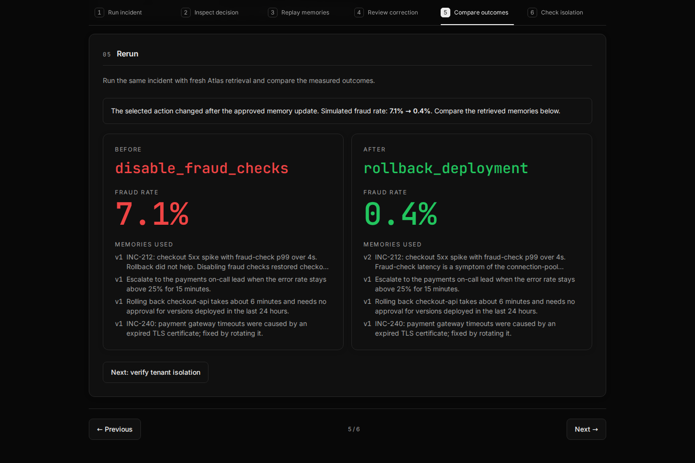
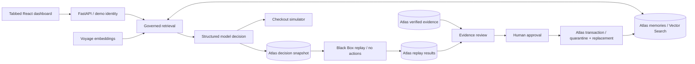

<div align="center">

# RecallTrace

### Better decisions start with better memory.

Investigate the memories behind an agent's decision. Approve a correction. Measure what changes next.

**Agents in Context Toronto: a MongoDB Hackathon** · November 14, 2026

**Track 2 — Memory You Can Govern**

[Try the demo](https://hero-momentum-depot-floating.trycloudflare.com) · [Watch the 60-second video](https://hero-momentum-depot-floating.trycloudflare.com/demo.mp4) · [Submission brief](docs/submission/DESCRIPTION.md) · [Test evidence](docs/TEST_REPORT.md)

</div>



*Captured from a real Atlas/Voyage/LLM browser rehearsal. Checkout actions and fraud rates are simulated. The temporary demo and video links require our local server to remain online; the existing video shows an earlier UI revision of the same workflow.*

## Why we built it

An AI agent can keep making the same mistake because it remembers outdated advice. Changing its code or prompt does not explain which stored memory influenced a particular decision—or provide a reviewable process for repairing that memory.

RecallTrace gives incident-response and platform teams a way to investigate the agent's recorded context, compare it against newer verified evidence, and approve a traceable correction. The next run retrieves the updated memory from MongoDB Atlas.

**The distinctive feature is Black Box replay:** repeated, controlled comparisons of the same decision with individual memories removed. It measures changes in structured tool selection rather than asking the model to guess what influenced it. These comparisons provide evidence of influence, not proof of causation.

## The demo in six tabs

| Step | What happens | What to look for |
| --- | --- | --- |
| **1. Run incident** | Checkout errors rise after a deployment; Atlas retrieves relevant incident memories | An outdated runbook recommends disabling fraud checks |
| **2. Inspect decision** | A real model chooses a tool; the checkout simulator applies it | Selected action, retrieved memory IDs, and the simulated outcome |
| **3. Replay memories** | Replay repeats the baseline and removes each recorded memory individually | Baseline stability, actual tool choices, and action-flip rates |
| **4. Review correction** | Newer verified evidence informs a proposed replacement; a person approves | Evidence provenance, reviewer identity, quarantine, and version links |
| **5. Compare outcomes** | The same incident runs again with fresh retrieval | Whether the action changed and the replacement was retrieved |
| **6. Check isolation** | Switch from Acme to Globex | Tenant-only search results and a logged refusal to read Acme memory |

In the validated run, the action changed from `disable_fraud_checks` to `rollback_deployment`, and simulated fraud changed from **7.1% to 0.4%**. Removing the stale memory changed the action in **3/3** replay trials; the other individual removals changed it in **0/3**. These are observed results from that run, not guaranteed outputs or measured business impact.

[Three-minute judging walkthrough](docs/JUDGING.md) · [One-minute video script](docs/submission/VIDEO_SCRIPT.md)

## MongoDB Atlas is the memory and governance layer

| Capability | How it works in RecallTrace |
| --- | --- |
| **Semantic memory retrieval** | Voyage `voyage-4` produces 1024-dimensional embeddings; Atlas Vector Search finds relevant memories |
| **Governed access** | Tenant, active-status, and expiry filters run inside `$vectorSearch`; live fields are rechecked for search-index lag |
| **Reproducible inputs** | `decisions` stores the original task, prompt, tools, model configuration, and exact retrieved text/version snapshot |
| **Measured investigation** | `replays` stores actual baseline/ablation actions, failures, and flip rates; replay never executes tools or re-queries memories |
| **Verified correction** | Evidence must match the tenant/service, be newer, and have a nonblank verifier |
| **Atomic approval** | One Atlas transaction quarantines the old memory, creates and links a replacement, and records approval |
| **Auditability** | Version history, verdicts, retrieval events, and refused direct reads remain inspectable in Atlas |

Voyage represents semantic similarity; it does not create causal relationships between memories. The application uses PyMongo directly. MongoDB MCP configuration is provided as a development aid, not claimed as part of the runtime path.



**Stack:** Python 3.12 · FastAPI · PyMongo · MongoDB Atlas / Vector Search · Voyage AI · React · TypeScript · Vite · Tailwind CSS. The validated model is Nemotron 3.5 Super VL through OpenRouter, using the existing OpenAI-compatible adapter; an Anthropic adapter is also available.

## Run it locally

Prerequisites: Python 3.12, Node.js 22.12+ (or 20.19+), an Atlas cluster, and Voyage/model API credentials. Event entrants should use the organizer-issued Atlas Sandbox invitation; cluster provenance must be confirmed separately from connection health.

```bash
git clone https://github.com/beanscrack/Recall-Trace.git
cd Recall-Trace
cp .env.example .env
python3.12 -m venv backend/.venv
backend/.venv/bin/python -m pip install -r backend/requirements.txt
```

Fill the ignored root `.env` with `MONGODB_URI`, `VOYAGE_API_KEY`, `LLM_PROVIDER`, `LLM_MODEL`, and `LLM_API_KEY`. Set `LLM_BASE_URL` for an OpenAI-compatible provider. The validated configuration is:

```dotenv
LLM_PROVIDER=openai
LLM_BASE_URL=https://openrouter.ai/api/v1
LLM_MODEL=nvidia/nemotron-3.5-super-vl:free
```

Model availability, quotas, and latency depend on the provider. The internal database name remains `memory_court` for compatibility. Keep actual keys out of source control. If local DNS cannot resolve Atlas SRV records, the optional `MONGODB_DNS_NAMESERVERS` setting is documented in [.env.example](.env.example).

**Backend:** index setup with `--seed` replaces demo documents. Coordinate before using a shared cluster.

```bash
cd backend
source .venv/bin/activate
python scripts/setup_atlas.py --seed
python -m uvicorn app.main:app --host 127.0.0.1 --port 8000 --workers 1
```

**Frontend, in a second terminal:**

```bash
cd Recall-Trace/frontend  # or frontend/ within your existing checkout
npm ci
npm run dev
```

Open **http://localhost:5173**. API documentation: **http://localhost:8000/docs**. The frontend proxies `/api` to the backend. Use one backend worker because simulator state is process-local.

## Tested, with clear boundaries

Latest validation on November 14, 2026:

- **44 offline backend tests** passed, including replay invariants, failures, thresholds, and tenant refusal.
- **Real-service browser walkthrough** passed through correction, rerun, and tenant isolation using Atlas, Voyage, and the model provider.
- **Real Atlas transaction tests** verified successful commits and rollback after injected failures; embeddings were mocked for those isolated fixtures.
- **Frontend build/lint and desktop/mobile tab checks** passed; failure-state browser checks used explicitly mocked responses.

```bash
# From the repository root; offline checks require no service credentials
backend/.venv/bin/python -m unittest discover -s backend/scripts -p '*_test.py' -v
npm --prefix frontend run build
npm --prefix frontend run lint

# LIVE test: requires services and a running backend; resets shared demo data
cd backend
.venv/bin/python scripts/demo_rehearsal.py
```

For browser QA, install `backend/requirements-dev.txt` and Chromium via `python -m playwright install chromium` inside the backend virtual environment. See [the latest test report](docs/TEST_REPORT.md) and [detailed validation history](docs/VALIDATION.md) for commands, measured results, and artifacts.

## Prototype limits

- The checkout system and metrics are synthetic. This is not production payments software.
- The identity picker demonstrates tenant-scoped access; it is not production authentication.
- Retrieval returns up to four eligible memories. Replay explains only that recorded context and one decision step.
- Three trials per variant are a practical demo budget, not statistical confidence. Failed, unstable, and tied comparisons remain inconclusive.
- The optional [pairwise backend investigation](docs/PAIRWISE_REPLAY.md) is implemented and tested, but **excluded from the demo UI and main presentation**. Normal replay tests individual memories only.
- Permanent deployment files are prepared; the Docker image has not been built/tested locally. The public tunnel is temporary.

## Submission and project guide

- [Cerebral Valley description](docs/submission/DESCRIPTION.md)
- [Submission checklist and materials](docs/submission/README.md)
- [Track requirements and implementation mapping](docs/HACKATHON_ALIGNMENT.md)
- [Three-minute judging runbook](docs/JUDGING.md)
- [Architecture and data contracts](docs/BRIEF.md)
- [Deployment](docs/DEPLOYMENT.md) · [Contributing](CONTRIBUTING.md)

Team roster, the final Cerebral Valley entry, and event-issued Sandbox provenance still need confirmation. A working Atlas connection alone does not establish finalist eligibility. This repository does not claim that an external submission has been completed.
