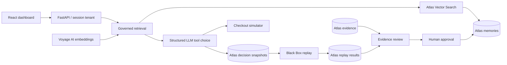

<div align="center">

# RecallTrace

**Trace the memory. Review the evidence. Change the next decision.**

Agent memory governance with MongoDB Atlas, Vector Search, and counterfactual replay.

[Architecture & build brief](docs/BRIEF.md) · [Team tasks](docs/TASKS.md) · [Hackathon alignment](docs/HACKATHON_ALIGNMENT.md) · [Contributing](CONTRIBUTING.md)

</div>

## The problem

An agent can repeat an unsafe action because its memory contains an outdated runbook. RecallTrace records exactly what the agent retrieved and uses repeated, single-step counterfactual replays to measure which memory's removal changes the selected tool. A reviewer can then approve a correction against newer evidence and rerun the incident through fresh Atlas retrieval.

Replay provides evidence of influence. Three samples do not establish causation or statistical confidence.

## Demo scenario

1. A checkout incident retrieves an outdated incident-response memory from Atlas Vector Search.
2. The agent chooses `disable_fraud_checks`; the simulated fraud rate rises.
3. **Black Box replay** removes one recorded memory at a time and reports action-flip rates.
4. **Evidence review** proposes a correction; a human approves quarantine and a linked replacement.
5. Fresh retrieval should lead the agent to `rollback_deployment`.
6. A second tenant's retrieval and direct-read checks demonstrate isolation.

All checkout actions are simulated. Replay itself executes no actions.

## Architecture



Atlas stores memories, evidence, decision snapshots, replay results, verdicts, and access logs. Retrieval pre-filters tenant, active status, and expiry inside `$vectorSearch`. Version links preserve correction history. The checkout simulator is held in process memory; its before/after snapshots are recorded with decisions.

| Component | Technology |
| --- | --- |
| Memory, audit, and decision persistence | MongoDB Atlas Hackathon Sandbox / PyMongo |
| Semantic retrieval | Atlas Vector Search |
| Embeddings | Voyage AI (`voyage-4`, 1024 dimensions by default) |
| Decision and correction drafts | Anthropic or OpenAI-compatible tool calling |
| API | Python 3.12 / FastAPI |
| Dashboard | React / TypeScript / Vite / Tailwind CSS |

## Run locally

Use the **event-issued Atlas Sandbox invitation** to create the project and cluster; an unrelated Atlas cluster does not satisfy the guide's finalist requirement.

Prerequisites: Python 3.12, Node.js 22.12+ (or 20.19+), a sandbox connection string, a Voyage API key, and an LLM API key with tool-calling support.

From the repository root:

```bash
cp .env.example .env
python3.12 -m venv backend/.venv
backend/.venv/bin/python -m pip install -r backend/requirements.txt
```

Fill in `.env`: `MONGODB_URI`, `VOYAGE_API_KEY`, `LLM_PROVIDER`, `LLM_MODEL`, and `LLM_API_KEY`. For an OpenAI-compatible endpoint, also set `LLM_BASE_URL`. Never commit credentials. The internal database namespace remains `memory_court` to preserve teammates' existing Atlas data and indexes; the product is named RecallTrace.

If your environment cannot resolve Atlas SRV records while public DNS can, set `MONGODB_DNS_NAMESERVERS=1.1.1.1,1.0.0.1` in `.env`. This optional override configures dnspython inside the backend process; it does not change system DNS. Leave it blank to use system defaults. See the [dnspython resolver documentation](https://dnspython.readthedocs.io/en/stable/resolver-class.html).

```bash
cd backend
source .venv/bin/activate
python scripts/flip_test.py           # real-provider prompt gate; requires LLM credentials
python scripts/setup_atlas.py --seed  # creates indexes, waits, then REPLACES demo documents
uvicorn app.main:app --reload --port 8000
```

In another terminal:

```bash
cd frontend
npm ci
npm run dev
```

The dashboard runs at `http://localhost:5173`, with `/api` proxied to port 8000. The API schema is at `http://localhost:8000/docs`.

## Validation and current status

```bash
cd backend
.venv/bin/python scripts/replay_test.py       # offline mocked LLM and collection tests
.venv/bin/python scripts/atlas_setup_test.py  # offline index-readiness checks
.venv/bin/python scripts/db_dns_test.py       # offline opt-in DNS checks
.venv/bin/python scripts/agent_failure_test.py # offline failed-agent behavior
.venv/bin/python scripts/isolation_check.py  # LIVE Atlas + Voyage check
.venv/bin/python scripts/demo_check.py       # LIVE API checks using existing data
.venv/bin/python scripts/demo_rehearsal.py   # LIVE full demo rehearsal against a running server (RESETS data)
```

Verified live on 2026-11-14 against Atlas with `claude-haiku-5-5` and `voyage-4`:

| Area | Current state |
| --- | --- |
| Gate 0 flip test | Passes 5/5 both ways on `claude-haiku-5-5`. Opus 5.5 / Sonnet 5.5 reject forced `tool_choice`; Opus 5 never follows the stale runbook |
| Atlas retrieval and embeddings | Verified: stale INC-212 ranks first, expired freeze memory never returned; `isolation_check.py` passes; live Atlas ping and six tenant/status/expiry retrieval checks passed |
| Snapshot replay | Verified: baseline 3/3, removing INC-212 flips 100%, other memories 0%; also covered by offline tests |
| Evidence review and approval | Verified: `correct` verdict from PM-31; approval is one transaction (quarantine, version 2, links, approval) |
| End-to-end before/after demo | Verified via `demo_rehearsal.py`: rerun retrieves v2 and rolls back; Globex search and refused read work |
| Dashboard | Wired to the live API; the full demo path (run, contest, replay, verdict, approve, rerun, Globex isolation) was clicked through in a browser |

The offline tests do **not** demonstrate successful Atlas retrieval, real LLM behavior, or a complete live demo. See the [alignment review](docs/HACKATHON_ALIGNMENT.md) for remaining gaps and the submission checklist.

For a Voyage account limited to 3 requests/minute, let prior requests age out and run the live check with `--interval 21`. The check requires nonempty results and verifies tenant, active status, expiry, direct-read refusal, and refusal logging. Existing Atlas demo data should be reused rather than reset during these checks.

## Development tools

`.mcp.json` configures the local MongoDB MCP server using `tools/mongodb-mcp.sh`. It reads the root `.env` and defaults to read-only. The application uses PyMongo directly. MongoDB's Agent Skills and query-prompting guidance from the resource guide are useful development aids; they are not application runtime dependencies.

For a fresh real-model decision and replay, run `scripts/flip_test.py`, then `scripts/demo_check.py --execute` from `backend/`. The latter checks LLM availability before any retrieval/write and never resets existing demo data. It uses current active memories, so it does not force the original bad action or an influential-memory result. Direct OpenAI remains blocked by exhausted API credits; the local configuration now uses OpenRouter Nemotron 3.5 Super VL, whose real flip gate and live decision/replay checks passed. See [team tasks](docs/TASKS.md) for the latest test results.

Validated alternative provider: `LLM_PROVIDER=openai`, `LLM_BASE_URL=https://openrouter.ai/api/v1`, `LLM_MODEL=nvidia/nemotron-3.5-super-vl:free`, and an OpenRouter key in the ignored `.env`. The flip gate passed 5/5 both ways; fresh decision/replay and forced correction-draft calls passed. Full Super VL approval/rerun rehearsal is still separate. See [validation results](docs/TASKS.md#nemotron-35-super-vl-validation).
