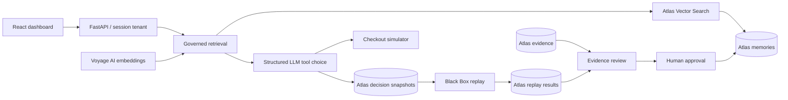

<div align="center">

# RecallTrace

**Trace the memory. Review the evidence. Change the next decision.**

Agent memory governance with MongoDB Atlas, Vector Search, and counterfactual replay.

[Live demo (temporary)](https://hero-momentum-depot-floating.trycloudflare.com) · [One-minute video](https://hero-momentum-depot-floating.trycloudflare.com/demo.mp4) · [Validation](docs/VALIDATION.md) · [Deployment](docs/DEPLOYMENT.md) · [Team tasks](docs/TASKS.md)

</div>

## The problem

An agent can repeat an unsafe action because its memory contains an outdated runbook. RecallTrace records exactly what the agent retrieved and uses repeated, single-step counterfactual replays to measure which memory's removal changes the selected tool. A reviewer can then approve a correction against newer evidence and rerun the incident through fresh Atlas retrieval.

Replay provides evidence of influence. Three samples do not establish causation or statistical confidence.

## Demo scenario

1. A checkout incident retrieves an outdated incident-response memory from Atlas Vector Search.
2. The agent chooses `disable_fraud_checks`; the simulated fraud rate rises.
3. **Black Box replay** removes one recorded memory at a time and reports action-flip rates.
4. **Evidence review** proposes a correction; a human approves quarantine and a linked replacement.
5. Fresh retrieval should lead the agent to `rollback_deployment`.
6. A second tenant's retrieval and direct-read checks demonstrate isolation.

All checkout actions are simulated. Replay itself executes no actions.

## Architecture



Atlas stores memories, evidence, decision snapshots, replay results, verdicts, and access logs. Retrieval pre-filters tenant, active status, and expiry inside `$vectorSearch`. Version links preserve correction history. The checkout simulator is held in process memory; its before/after snapshots are recorded with decisions.

| Component | Technology |
| --- | --- |
| Memory, audit, and decision persistence | MongoDB Atlas Hackathon Sandbox / PyMongo |
| Semantic retrieval | Atlas Vector Search |
| Embeddings | Voyage AI (`voyage-4`, 1024 dimensions by default) |
| Decision and correction drafts | Nemotron 3.5 Super VL through OpenRouter; Anthropic/OpenAI-compatible adapters |
| API | Python 3.12 / FastAPI |
| Dashboard | React / TypeScript / Vite / Tailwind CSS |

## Run locally

Use the **event-issued Atlas Sandbox invitation** to create the project and cluster; an unrelated Atlas cluster does not satisfy the guide's finalist requirement.

Prerequisites: Python 3.12, Node.js 22.12+ (or 20.19+), a sandbox connection string, a Voyage API key, and an LLM API key with tool-calling support.

From the repository root:

```bash
cp .env.example .env
python3.12 -m venv backend/.venv
backend/.venv/bin/python -m pip install -r backend/requirements.txt
```

Fill in `.env`: `MONGODB_URI`, `VOYAGE_API_KEY`, `LLM_PROVIDER`, `LLM_MODEL`, and `LLM_API_KEY`. For an OpenAI-compatible endpoint, also set `LLM_BASE_URL`. Never commit credentials. The internal database namespace remains `memory_court` to preserve teammates' existing Atlas data and indexes; the product is named RecallTrace.

If your environment cannot resolve Atlas SRV records while public DNS can, set `MONGODB_DNS_NAMESERVERS=1.1.1.1,1.0.0.1` in `.env`. This optional override configures dnspython inside the backend process; it does not change system DNS. Leave it blank to use system defaults. See the [dnspython resolver documentation](https://dnspython.readthedocs.io/en/stable/resolver-class.html).

```bash
cd backend
source .venv/bin/activate
python scripts/flip_test.py           # real-provider prompt gate; requires LLM credentials
python scripts/setup_atlas.py --seed  # creates indexes, waits, then REPLACES demo documents
uvicorn app.main:app --reload --port 8000
```

In another terminal:

```bash
cd frontend
npm ci
npm run dev
```

The dashboard runs at `http://localhost:5173`, with `/api` proxied to port 8000. The API schema is at `http://localhost:8000/docs`.

## Validation and current status

```bash
cd backend
.venv/bin/python scripts/replay_test.py       # offline mocked LLM and collection tests
.venv/bin/python scripts/atlas_setup_test.py  # offline index-readiness checks
.venv/bin/python scripts/db_dns_test.py       # offline opt-in DNS checks
.venv/bin/python scripts/agent_failure_test.py # offline failed-agent behavior
.venv/bin/python scripts/isolation_check.py  # LIVE Atlas + Voyage check
.venv/bin/python scripts/demo_check.py       # LIVE API checks using existing data
.venv/bin/python scripts/demo_rehearsal.py   # LIVE full demo rehearsal against a running server (RESETS data)
```

Verified on November 14, 2026 with real Atlas, Voyage, and Nemotron 3.5 Super VL through OpenRouter:

| Area | Result |
| --- | --- |
| Full HTTP and public-browser demo | Passed: unsafe decision, replay, verified correction, named approval, rollback rerun, and tenant isolation |
| Recorded influence | Stable baseline 3/3; removing stale INC-212 flips 3/3; other memories 0/3 |
| Before/after | Simulated fraud 7.1% after disabling checks, 0.4% after corrected rollback |
| Evidence eligibility | Requires the same tenant/service, a newer date, and a nonblank verifier, including fallback queries |
| Approval | One Atlas transaction; live failure-injection checks verify full rollback and successful commit |
| Reliability | 34 offline tests pass; failed/unstable/inconclusive replay states have explicit UI messaging and retry |
| Frontend | Real API wiring; full browser walkthrough, production build, and lint pass |
| Demo video | Exactly 60 seconds; real browser captures and source excerpts with generated narration; audio/video playback verified |

The [validation report](docs/VALIDATION.md) distinguishes live tests from mocked failure cases and records the remaining limits. The public tunnel is temporary and requires the local server to stay running. [Deployment files](docs/DEPLOYMENT.md) are prepared for permanent hosting; the Docker build has not been run because the local Docker engine is unavailable.

The embedding cache stores only query vectors; tenant-specific memories and retrieval results are never cached. Repeating the incident for rerun and tenant checks reuses its vector while each search still applies fresh Atlas eligibility filters. For other low-tier Voyage checks, `scripts/isolation_check.py --interval 21` spaces embedding requests.

## Development tools

`.mcp.json` configures the local MongoDB MCP server using `tools/mongodb-mcp.sh`. It reads the root `.env` and defaults to read-only. The application uses PyMongo directly. MongoDB's Agent Skills and query-prompting guidance from the resource guide are useful development aids; they are not application runtime dependencies.

For a fresh real-model decision and replay, run `scripts/flip_test.py`, then `scripts/demo_check.py --execute` from `backend/`. These checks do not reset the demo. For the full reset/approval/rerun path, use `scripts/demo_rehearsal.py` or the optional browser checker in [VALIDATION.md](docs/VALIDATION.md).

Validated local provider settings (keep the actual key only in the ignored `.env`):

```dotenv
LLM_PROVIDER=openai
LLM_BASE_URL=https://openrouter.ai/api/v1
LLM_MODEL=nvidia/nemotron-3.5-super-vl:free
LLM_API_KEY=your_openrouter_key
```

The [submission description](docs/submission/DESCRIPTION.md), [measured run](docs/submission/validated-run.json), and one-minute video are prepared. Final team details, event Sandbox confirmation, and competition submission are deferred at the user's request. GitHub About changes require the repository owner's account; [exact metadata and command](docs/DEPLOYMENT.md#github-about-owner-only-step) are provided.
