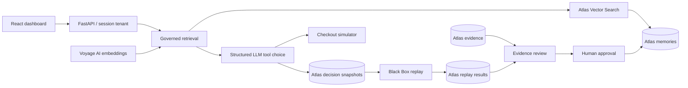

<div align="center">

# RecallTrace

**Trace the memory. Review the evidence. Change the next decision.**

Agent memory governance with MongoDB Atlas, Vector Search, and counterfactual replay.

[Architecture & build brief](docs/BRIEF.md) · [Hackathon alignment](docs/HACKATHON_ALIGNMENT.md) · [Contributing](CONTRIBUTING.md)

</div>

## The problem

An agent can repeat an unsafe action because its memory contains an outdated runbook. RecallTrace records exactly what the agent retrieved and uses repeated, single-step counterfactual replays to measure which memory's removal changes the selected tool. A reviewer can then approve a correction against newer evidence and rerun the incident through fresh Atlas retrieval.

Replay provides evidence of influence. Three samples do not establish causation or statistical confidence.

## Demo scenario

1. A checkout incident retrieves an outdated incident-response memory from Atlas Vector Search.
2. The agent chooses `disable_fraud_checks`; the simulated fraud rate rises.
3. **Black Box replay** removes one recorded memory at a time and reports action-flip rates.
4. **Evidence review** proposes a correction; a human approves quarantine and a linked replacement.
5. Fresh retrieval should lead the agent to `rollback_deployment`.
6. A second tenant's retrieval and direct-read checks demonstrate isolation.

All checkout actions are simulated. Replay itself executes no actions.

## Architecture



Atlas stores memories, evidence, decision snapshots, replay results, verdicts, and access logs. Retrieval pre-filters tenant, active status, and expiry inside `$vectorSearch`. Version links preserve correction history. The checkout simulator is held in process memory; its before/after snapshots are recorded with decisions.

| Component | Technology |
| --- | --- |
| Memory, audit, and decision persistence | MongoDB Atlas Hackathon Sandbox / PyMongo |
| Semantic retrieval | Atlas Vector Search |
| Embeddings | Voyage AI (`voyage-4`, 1024 dimensions by default) |
| Decision and correction drafts | Anthropic or OpenAI-compatible tool calling |
| API | Python 3.12 / FastAPI |
| Dashboard | React / TypeScript / Vite / Tailwind CSS |

## Run locally

Use the **event-issued Atlas Sandbox invitation** to create the project and cluster; an unrelated Atlas cluster does not satisfy the guide's finalist requirement.

Prerequisites: Python 3.12, Node.js 22.12+ (or 20.19+), a sandbox connection string, a Voyage API key, and an LLM API key with tool-calling support.

From the repository root:

```bash
cp .env.example .env
python3.12 -m venv backend/.venv
backend/.venv/bin/python -m pip install -r backend/requirements.txt
```

Fill in `.env`: `MONGODB_URI`, `VOYAGE_API_KEY`, `LLM_PROVIDER`, `LLM_MODEL`, and `LLM_API_KEY`. For an OpenAI-compatible endpoint, also set `LLM_BASE_URL`. Never commit credentials. The internal database namespace remains `memory_court` to preserve teammates' existing Atlas data and indexes; the product is named RecallTrace.

```bash
cd backend
source .venv/bin/activate
python scripts/flip_test.py           # real-provider prompt gate; requires LLM credentials
python scripts/setup_atlas.py --seed  # creates indexes, waits, then REPLACES demo documents
uvicorn app.main:app --reload --port 8000
```

In another terminal:

```bash
cd frontend
npm ci
npm run dev
```

The dashboard runs at `http://localhost:5173`, with `/api` proxied to port 8000. The API schema is at `http://localhost:8000/docs`.

## Validation and current status

```bash
cd backend
.venv/bin/python scripts/replay_test.py       # offline mocked LLM and collection tests
.venv/bin/python scripts/atlas_setup_test.py  # offline index-readiness checks
.venv/bin/python scripts/isolation_check.py  # LIVE Atlas + Voyage check
```

| Area | Current state |
| --- | --- |
| Snapshot replay | Implemented; offline tests cover thresholds, failures, ties, concurrency, and the HTTP route |
| Atlas retrieval and embeddings | Implemented; requires live sandbox validation |
| Evidence review and approval | Implemented by the team; requires live validation |
| Dashboard | Mock-data prototype; API wiring and interactive demo controls remain |
| End-to-end before/after demo | Requires credentials, prompt gate, and a complete rehearsal |

The offline tests do **not** demonstrate successful Atlas retrieval, real LLM behavior, or a complete live demo. See the [alignment review](docs/HACKATHON_ALIGNMENT.md) for remaining gaps and the submission checklist.

## Development tools

`.mcp.json` configures the local MongoDB MCP server using `tools/mongodb-mcp.sh`. It reads the root `.env` and defaults to read-only. The application uses PyMongo directly. MongoDB's Agent Skills and query-prompting guidance from the resource guide are useful development aids; they are not application runtime dependencies.
